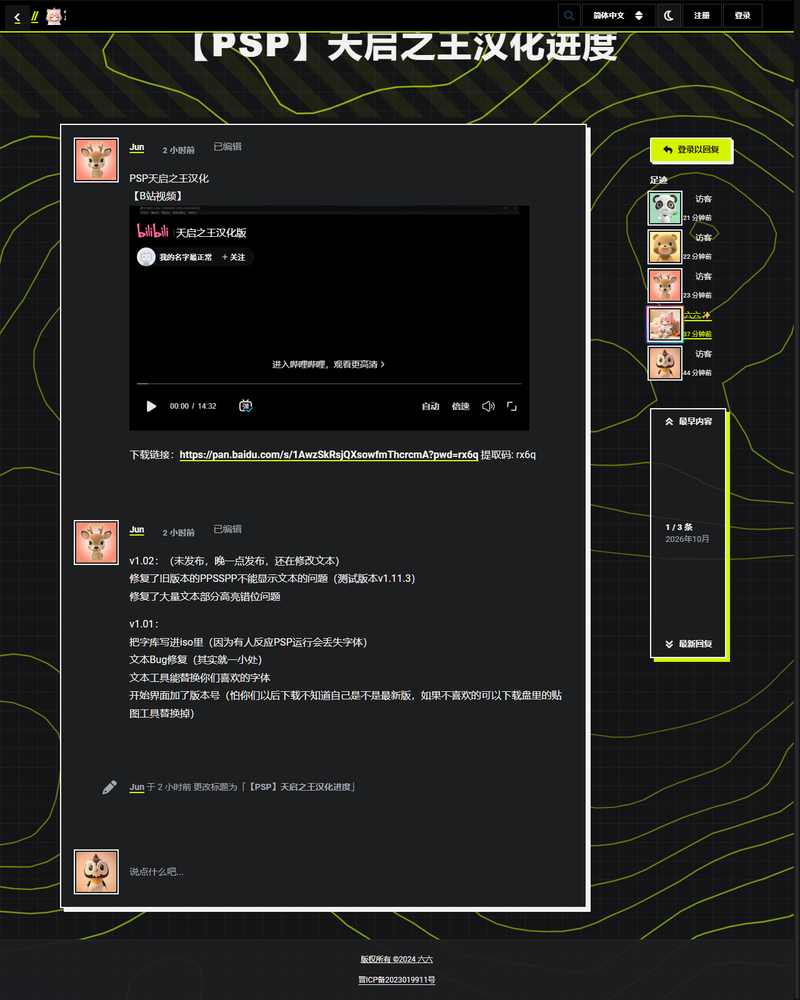

# MediaEmbed 中文站点（liufencn/flarum-mediaembed）

给 Flarum 2.x 的富文本引擎补上**国内常用视频 / 音乐站点**：帖子里的 B 站、AcFun、腾讯视频、网易云音乐、西瓜视频链接，发帖后自动渲染成内嵌播放器，不再只是普通超链接。

**零依赖、零配置**——装好启用即用，不改动 Flarum 核心与任何 vendor 文件。



## 为什么需要这个扩展

Flarum 2.x 的富文本由 [s9e/TextFormatter](https://github.com/s9e/TextFormatter) 渲染，「链接变播放器」靠它的 **MediaEmbed 插件**：解析时把裸 URL 包成 `MEDIA` 标签 → 按 host 查站点表 → 命中就换成 `<BILIBILI>` / `<YOUTUBE>` 之类标签再渲染成 iframe。

s9e 内置站点表有 136 个站点（YouTube / Vimeo / Dailymotion / SoundCloud / Spotify / TikTok / Twitch / 优酷……），**国内站一个都没有**。`fof/formatting` 负责装上 MediaEmbed，但只额外注册了 youtube 一个站点。本扩展就是补这一块。

## 支持的站点

| 站点 | 链接形态 | 播放器 |
|---|---|---|
| Bilibili | `video/BV号`、`video/av号`、`?p=N` 分P、带 `share_source` 等尾巴的分享链接、无 www / `m.` 子域 | `player.bilibili.com` |
| AcFun | `acfun.cn/v/ac+ID` | `acfun.cn/player` |
| 腾讯视频 | `x/cover/{cid}/{vid}.html`、`x/page/{vid}.html`、`cover/...?vid=` 等 6 种形态 | `v.qq.com/txp/iframe` |
| 网易云音乐 | 单曲 / 专辑 / 歌单，含 `#/` hash 路由与 `song/33894312` 斜杠式 | `music.163.com/outchain` |
| 西瓜视频 | `ixigua.com/{长ID}` | `ixigua.com/iframe` |

各站点播放器地址均于 2026-10-15 用真实 ID 实测返回真播放器页（B 站另在真实浏览器中取到 206 视频分片）。西瓜视频的 iframe 是纯 JS SPA，无法从服务端端到端验证，播不了可单独删除 `extend.php` 中对应段落，不影响其他站点。

**有意不做**：`b23.tv` 短链（302 跳转需发 HTTP 请求，会让发帖渲染依赖外网）、`space.bilibili.com` 合集、`bilibili.com/read/cv` 专栏（非视频）。

**正确不嵌**：`news.qq.com` 等腾讯非视频页（host 刻意只写 `v.qq.com`）、`evil.com/bilibili.com/...` 伪造域名、百度网盘、GitHub。

## 安装

```bash
composer require liufencn/flarum-mediaembed
php flarum extension:enable liufencn-mediaembed
php flarum cache:clear
```

也可以手动部署：把本仓库放到 `extensions/liufencn-mediaembed/`，再在后台启用。扩展 id 为 `liufencn-mediaembed`。

## 历史数据兼容

站内历史数据里存着早年用别的扩展生成的 `<BILIBILI bvid="1iM4y1y7oA">` 标签（属性名 `bvid`、值是**裸号**无 `BV` 前缀）。本扩展的属性名与历史数据同名，模板对值做前缀兼容——**存量帖无需重解析即可播放**。

注意 s9e 的硬特性：文本在**发帖那一刻**就解析成 XML 存库，渲染直接用存量 XML。新增站点只影响之后解析的文本；已发帖里的裸链接需要重解析才会变播放器（`$formatter->unparse($old)` → `parse($text)` → 更新 `content` 列）。

## 依赖兜底

正常情况 MediaEmbed 已被 `fof/formatting` 装好，直接 `add` 站点即可。万一 `fof/formatting` 被停用 / 卸载，`extend.php` 里的兜底分支会自己把插件 load 进来，保证本扩展独立可用。

## 测试

`verify.php` 是 26 用例的离线验证台（重绑内存缓存避开 Formatter 缓存）：

```bash
php verify.php   # 期望 PASS 25 / FAIL 0（另 1 例负例断言"不嵌"）
```

## 致谢

- [Flarum](https://flarum.org) — MIT
- [s9e/TextFormatter](https://github.com/s9e/TextFormatter) — MIT（MediaEmbed 插件与站点定义机制的提供者）

## License

**AGPL-3.0-or-later** — 可自由使用、修改、商用；但若你修改后对外提供服务，必须以相同许可开源你的改动。完整条款见 [LICENSE](LICENSE)。

## 联系作者 / Contact

| 渠道 | 地址 |
|---|---|
| 🏝️ 论坛（CatIsland） | https://bbs.cathi.cn |
| 💬 QQ 交流群 | 369748859 |
| 📮 邮箱 | 792818521@qq.com |
